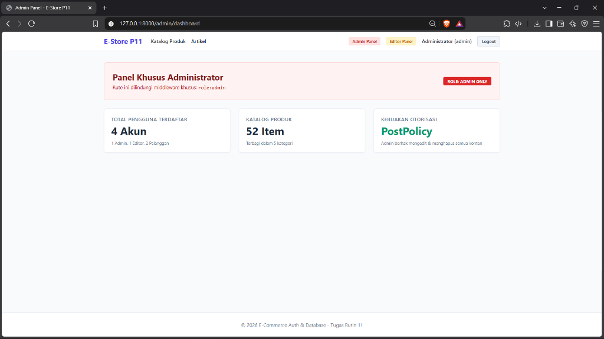
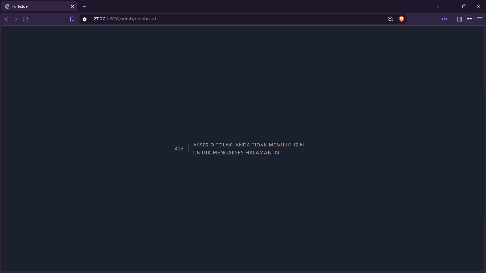
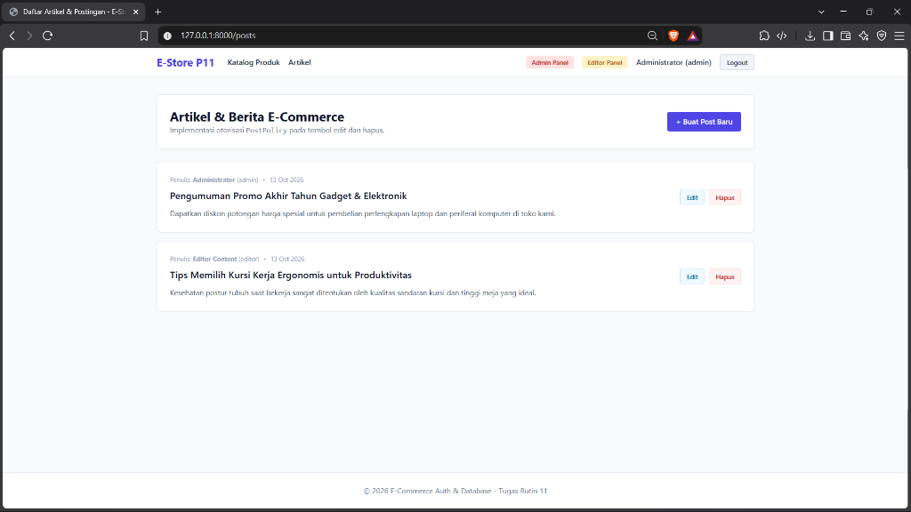
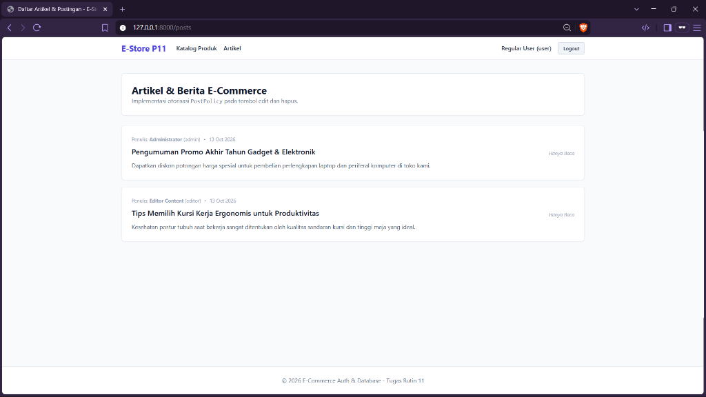
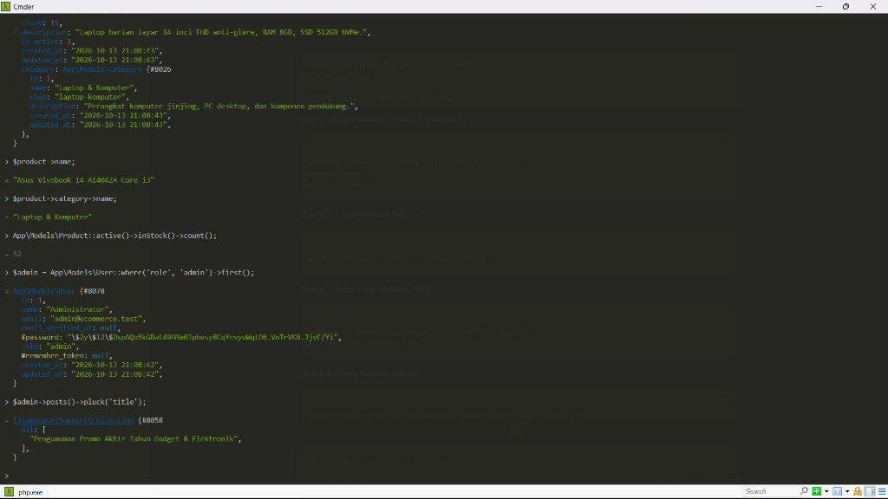
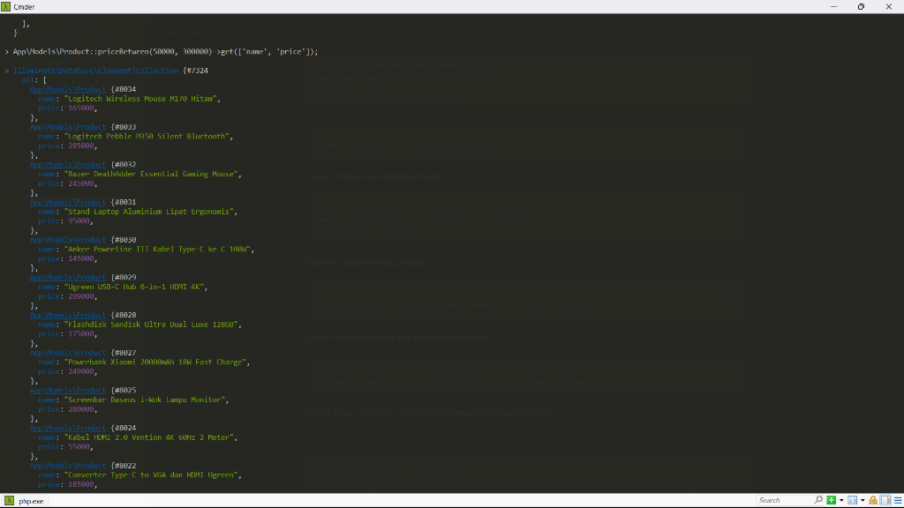
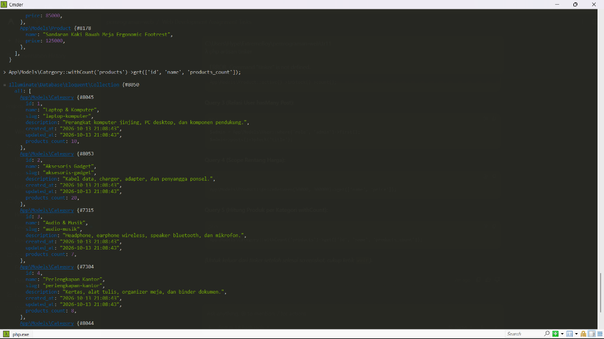

# E-Store Backend & Multi-Role Authentication System

Sistem manajemen basis data e-commerce dan autentikasi multi-peran (Role-Based Access Control) berbasis Laravel 11.

## Fitur Utama

- **Skema Relasional E-Commerce (7 Tabel)**:
  - `users`: Autentikasi dan data pengguna dengan peran `admin`, `editor`, dan `user`.
  - `categories`: Pengelompokan jenis barang.
  - `products`: Katalog produk lengkap dengan harga, stok, dan deskripsi.
  - `posts`: Publikasi artikel promo dan informasi toko.
  - `orders`: Pencatatan transaksi belanja pelanggan.
  - `order_items`: Rincian produk dan subtotal dalam tiap transaksi pesanan.
  - `reviews`: Ulasan dan rating kepuasan pembeli terhadap barang.
- **Data Uji Realistis**: Dilengkapi data awal lebih dari 50 barang komputer, periferal, dan perlengkapan kantor lengkap dengan harga riil.
- **Sistem Autentikasi & Multi-Role**:
  - Alur Masuk (Login), Daftar (Register), dan Keluar (Logout).
  - Middleware khusus `role` untuk membatasi akses halaman sensitif.
  - Akses panel khusus Administrator (`/admin/dashboard`).
  - Akses panel khusus Tim Editorial (`/editor/dashboard`).
- **Otorisasi Konten (PostPolicy)**:
  - `Admin`: Berhak mengedit dan menghapus seluruh konten artikel.
  - `Editor`: Hanya berhak mengedit dan menghapus konten buatannya sendiri.
  - `User`: Hanya memiliki hak membaca tanpa tombol aksi modifikasi.
- **Optimasi Query**: Menerapkan teknik Eager Loading (`with('category')`) untuk mencegah beban kueri berlebih pada katalog produk.

## Tampilan Antarmuka & Uji Autentikasi

### 1. Panel Khusus Administrator (Role: Admin)


### 2. Proteksi Middleware Multi-Role (403 Forbidden saat Diakses Non-Admin)


### 3. Otorisasi Konten PostPolicy (Akses Administrator: Izin Penuh Edit & Hapus)


### 4. Otorisasi Konten PostPolicy (Akses Pelanggan / User: Mode Hanya Baca)


## Pengujian Query Eloquent ORM (Laravel Tinker)

### 1. Eager Loading, Local Scope (Active & InStock), dan Relasi User-Post (Query 1 - 3)


### 2. Local Scope Filter Rentang Harga (Query 4)


### 3. Agregasi Jumlah Relasi Produk per Kategori withCount (Query 5)


## Akun Uji Coba

| Peran (Role) | Alamat Email | Kata Sandi |
|---|---|---|
| Administrator | `admin@ecommerce.test` | `password123` |
| Editor Konten | `editor@ecommerce.test` | `password123` |
| Pelanggan Biasa | `user@ecommerce.test` | `password123` |

## Cara Instalasi & Menjalankan

1. Masuk ke direktori:
   ```bash
   cd tr11
   ```

2. Pasang dependensi aplikasi:
   ```bash
   composer install
   ```

3. Buat basis data MySQL baru bernama `db_p11_ecommerce`.

4. Generate application key:
   ```bash
   php artisan key:generate
   ```

5. Jalankan migrasi tabel beserta pengisian data awal:
   ```bash
   php artisan migrate --seed
   ```

6. Jalankan server lokal:
   ```bash
   php artisan serve
   ```

7. Buka browser pada alamat `http://127.0.0.1:8000`.
